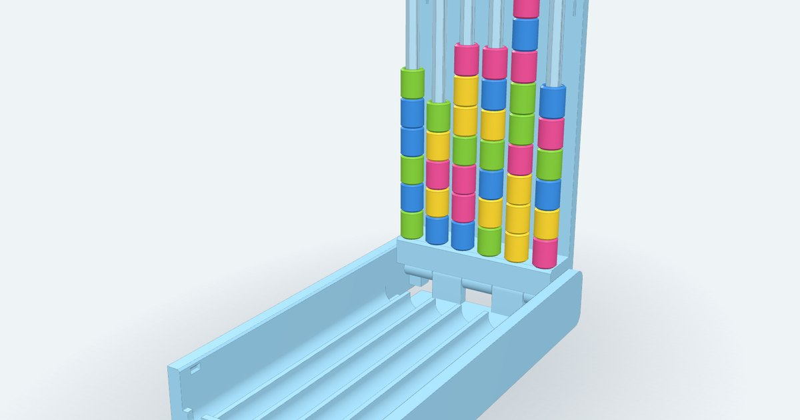
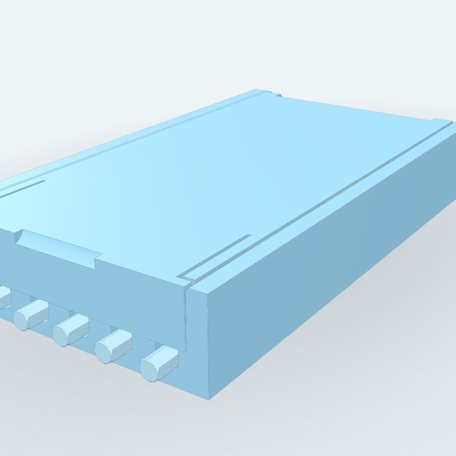
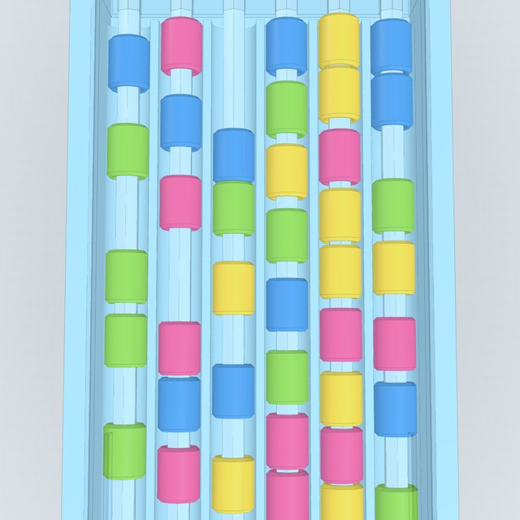
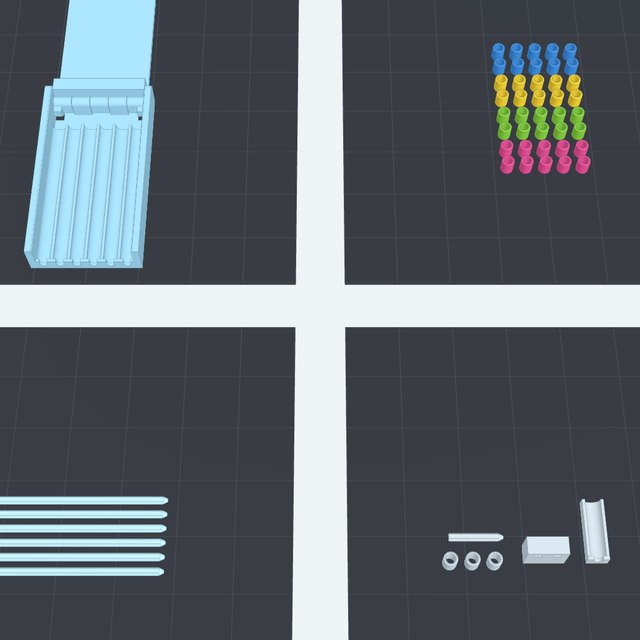

# Ordina-colori

Gioco di ordinamento stampabile in 3D su **Bambu Lab P1S**: 40 anelli in 4 colori su 6 aste, da riordinare
finché ogni asta ha un solo colore. Ispirato al *Mini Color Stack*: la scatola mescola gli anelli e li
riallinea da sola, senza toccarli uno a uno.

**Sito con modelli 3D, animazioni e partita giocabile:** https://davide6414.github.io/Color_toy_fidget_stack/



| Scatola chiusa | Dentro, dopo l'agitata | Piatti di stampa |
| --- | --- | --- |
|  |  |  |

## Come si gioca

1. **Sfila le aste.** A scatola chiusa si tirano fuori dalle tacche frontali: gli anelli restano dentro.
2. **Agita.** Gli anelli sono più lunghi che larghi (10 contro 8 mm): possono fermarsi solo distesi lungo
   i 6 binari, con il foro già in asse.
3. **Reinfila le aste.** Ognuna attraversa gli anelli del suo binario e si innesta nella barra in fondo.
4. **Apri il coperchio a 90°.** La barra è solidale al coperchio: le aste si alzano in verticale, i magneti
   tengono il coperchio aperto e gli anelli scivolano sulla barra.
5. **Gioca.** Un anello alla volta dalla cima di un'asta all'altra, su un'asta vuota o sopra lo stesso
   colore, massimo 10 per asta. Vinci quando ogni asta ha un solo colore.
6. **Chiudi.** Anche a partita in corso: le aste tornano nei binari con gli anelli infilati.

## Cosa stampare

| File | Quantità | Orientamento | Note |
| --- | --- | --- | --- |
| [scatola.stl](stl/scatola.stl) | 1 | aperta a 180°, già orientata | print in place; **pausa a Z = 9,4 mm** per i magneti |
| [anelli_x10.stl](stl/anelli_x10.stl) | 4 piatti | in piedi | uno per colore (rosa, verde, giallo, blu), o tutti insieme con l'AMS |
| [aste_x6.stl](stl/aste_x6.stl) | 1 | distese su una faccia | strati lungo tutta la lunghezza |
| [piatto_di_prova.stl](stl/piatto_di_prova.stl) | 1 | già orientato | da stampare prima, per tarare i giochi |
| magneti Ø 6 × 3 mm | 4 | — | da acquistare (N35 o superiore) |

Tutto in un file: [ordina-colori-stl.zip](stl/ordina-colori-stl.zip). Nessun supporto, nessun brim.
Ugello 0,4, strato 0,2, PLA. Compensazione del piede d'elefante attiva (0,1–0,15 mm).

**Montaggio:** nessuno, a parte i magneti. Alla pausa si infilano di taglio nelle 4 sedi aperte in alto.
Prima della stampa attaccali a coppie e segna la faccia libera: nelle pareti della base il segno va verso
l'esterno, nelle guance del coperchio verso l'interno. Finita la stampa si piega il coperchio per sbloccare la
cerniera, si chiude con uno scatto e si infilano le aste.

Ingombro: scatola chiusa 68,4 × 125 × 20 mm (più 5 mm di code delle aste), aperta 234,8 mm.

## Scelte costruttive

- **Cerniera print in place con l'asse a metà altezza.** Base e coperchio si stampano entrambi appoggiati sul
  piatto solo se l'asse sta a metà dei 20 mm di altezza. Nocche alternate base/coperchio di raggio 3,5 con
  perni conici a 45° e 0,3 mm di gioco.
- **Barra solidale al coperchio.** Ruota sempre davanti all'asse; i binari finiscono 2 mm prima della barra
  per lasciar passare il suo spigolo inferiore.
- **Fermo a 90° con 4 magneti, una sola pausa.** Due nelle guance posteriori del coperchio, due nelle pareti
  laterali, tutti con l'asse orizzontale. A 90° si trovano faccia a faccia attraverso le pareti; non c'è una
  battuta rigida, quindi il coperchio arriva a 180° per la stampa. Le quattro sedi finiscono alla stessa
  quota di stampa.
- **Chiusura frontale a scatto.** Due linguette elastiche ricavate nel piano del coperchio (si flettono nel
  piano degli strati, 0,6% di deformazione) con un dentino a 45° che scatta in una sede delle pareti.
  Non servono altri magneti né altre pause.
- **Tacche frontali** con il fondo concentrico all'asse dei binari: a scatola chiusa la gonna del coperchio le
  chiude in alto e diventano fori di guida; aprendo, lasciano salire la coda delle aste.
- **Regole di gioco** come il Color Stack originale (un anello alla volta, solo su asta vuota o sullo stesso
  colore, massimo 10). Nel sito c'è anche la regola libera e un risolutore che dice se la mescolata è
  risolvibile.

## Il sito

- Modello 3D interattivo: scatola aperta e chiusa, sezione lungo un binario, coperchio trasparente, piatti di stampa.
- Animazione della partita completa (6 passi) e del funzionamento di binari, tacche, barra, cerniera, magneti e linguette.
- Partita giocabile sulle aste verticali, con annulla, suggerimento e risoluzione automatica.
- Modello parametrico: giochi, sporgenza delle code, capienza, smussi e risoluzione si regolano dal pannello
  *Parametri*; gli STL scaricati usano i valori scelti.
- Guida di stampa per la P1S con la pausa dei magneti e la lista del piatto di prova.

La geometria è generata con [manifold-3d](https://github.com/elalish/manifold) (booleane esatte, mesh sempre
chiuse) e visualizzata con [three.js](https://threejs.org/). Lo stesso codice gira in Node per produrre gli
STL della cartella `stl/` e per le verifiche.

## Verifiche automatiche

`npm test` controlla, con i parametri predefiniti e con i cursori agli estremi:
- solidi chiusi e quote delle specifiche;
- esclusione delle posizioni sbagliate degli anelli (di traverso, in piedi, sopra un binario pieno);
- assieme senza compenetrazioni con 10 anelli per binario;
- rotazione del coperchio da 0° a 180° senza urti, anche con aste e anelli infilati;
- scatto delle linguette e allineamento dei magneti a 90° con una sola pausa;
- piatti di stampa entro i 256 mm;
- regole e risolutore della partita.

## Struttura

```
index.html            sito (GitHub Pages)
css/style.css
js/params.js          parametri primari e quote derivate
js/geometry.js        solidi CSG di scatola, aste, anelli, piatti di stampa e piatto di prova
js/game.js            regole, agitata, risolutore (anche in js/solver-worker.js)
js/viewer.js          scena three.js, cinematica di coperchio, aste e anelli
js/sequences.js       animazioni d'uso e dei pezzi
js/play.js            partita sugli anelli 3D
js/main.js            interfaccia
tools/check.mjs       verifiche della geometria
tools/test-game.mjs   verifiche della logica di gioco
tools/build-stl.mjs   genera stl/*.stl e lo zip
```

## Sviluppo

```bash
npm install
npm test            # geometria e logica di gioco
npm run build:stl   # rigenera gli STL
npm run serve       # http://localhost:8080
```

Il workflow `.github/workflows/pages.yml` verifica, rigenera gli STL e pubblica il sito a ogni push su `main`.
Va attivato una volta: **Settings → Pages → Source: GitHub Actions**.
