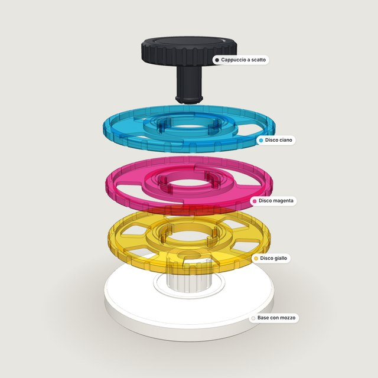
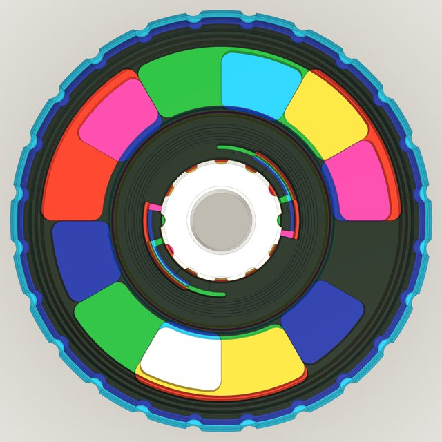

# Color Fidget Stack

Giocattolo antistress stampabile in 3D: tre **dischi traslucidi** — giallo, magenta e ciano — infilati su un
mozzo scanalato. Ogni disco **scatta ogni 30°**; le finestre aperte si sovrappongono e i filtri si sommano
come in una stampa a colori (miscela sottrattiva). Un **cappuccio a scatto** tiene insieme la pila e gira
come una trottola.

**Sito interattivo:** https://davide6414.github.io/Color_toy_fidget_stack/


| Esploso | Vista dall'alto |
| --- | --- |
|  |  |

## Pezzi

| # | Pezzo | Filamento | STL |
| --- | --- | --- | --- |
| 1 | Base con mozzo | PLA/PETG bianco opaco | [01_base.stl](stl/01_base.stl) |
| 2 | Disco giallo (6 finestre da 30°) | PETG/PLA traslucido giallo | [02_disco_giallo.stl](stl/02_disco_giallo.stl) |
| 3 | Disco magenta (2 finestre da 90°) | PETG/PLA traslucido magenta | [03_disco_magenta.stl](stl/03_disco_magenta.stl) |
| 4 | Disco ciano (3 finestre da 60°) | PETG/PLA traslucido ciano | [04_disco_ciano.stl](stl/04_disco_ciano.stl) |
| 5 | Cappuccio a scatto | PETG (consigliato) | [05_cappuccio.stl](stl/05_cappuccio.stl) |

Tutti insieme: [color-fidget-stack-stl.zip](stl/color-fidget-stack-stl.zip). Gli STL sono già
nell'orientamento di stampa e nessun pezzo richiede supporti. Ingombro montato: Ø 60 × 22,9 mm.

## Come funziona

- **Base e mozzo** — il mozzo centrale ha 12 scanalature verticali (12 posizioni × 30°). Un anello in
  rilievo tiene il primo disco sollevato di 0,4 mm. Dentro c'è un foro con un gradino conico a 45° dove si
  aggancia il cappuccio; il foro sbuca sotto la base per lo smontaggio.
- **Dischi** — nello spessore di ogni disco ci sono due bracci curvi separati da una fessura, con un
  dentino che entra in una scanalatura del mozzo. Girando, il braccio si flette di 0,5 mm verso l'esterno e
  ricade nella scanalatura successiva: clic. La flessione avviene nel piano di stampa, dove la plastica è
  più resistente. Le finestre sono multipli di 30°, così a ogni scatto i bordi coincidono.
- **Cappuccio** — due tagli incrociati dividono il perno in 4 alette elastiche con un dente conico
  (invito e ritorno a 45°). Nel foro stretto le alette si chiudono di 0,35 mm e si riaprono sotto il
  gradino. Il perno ha 0,1 mm di gioco: il cappuccio gira libero senza trascinare i dischi.
- **Colori** — sopra la base bianca: ciano + magenta = blu, magenta + giallo = rosso, ciano + giallo =
  verde, tutti e tre = quasi nero. 12³ = 1728 combinazioni.

## Il sito

- Modello 3D interattivo: vista montata/esplosa, sezione, vista dall'alto, trascinamento dei dischi con
  scatti e suono.
- Animazioni del funzionamento di ogni parte: montaggio, mozzo, scatto dei dischi, aggancio del cappuccio,
  miscela dei colori, smontaggio con la penna.
- **Modello parametrico**: giochi, profondità del dentino, sottosquadro dell'aggancio, spessore del filtro
  e risoluzione si regolano dal pannello *Parametri*; gli STL scaricati usano i valori scelti.
- Guida di stampa e montaggio.

La geometria è generata nel browser con [manifold-3d](https://github.com/elalish/manifold) (booleane CSG
che garantiscono mesh chiuse) e visualizzata con [three.js](https://threejs.org/). Lo stesso codice gira in
Node per produrre gli STL della cartella `stl/`.

## Stampa in breve

- Ugello 0,4 mm, strato 0,2 mm (0,12–0,16 mm per il cappuccio).
- Dischi: 3 perimetri, riempimento 100%; base 15–20%; cappuccio 4 perimetri.
- Compensazione del piede d'elefante 0,1–0,2 mm.
- Se i dischi girano duri aumenta il *gioco disco ↔ mozzo*; se il cappuccio non tiene aumenta il
  *sottosquadro aggancio*.

## Struttura del progetto

```
index.html          pagina del sito (GitHub Pages)
css/style.css       stile
js/params.js        parametri e quote derivate
js/geometry.js      geometria CSG dei 5 pezzi (browser e Node)
js/mechanics.js     cinematica di dentini e alette
js/stl.js           esportazione STL binaria
js/viewer.js        scena three.js, sezione, esploso, trascinamento
js/sequences.js     animazioni del funzionamento
js/main.js          interfaccia
tools/check.mjs     verifiche: solidi validi, nessuna compenetrazione, meccanismi che fanno presa
tools/build-stl.mjs genera stl/*.stl e lo zip
stl/                STL pronti con i parametri predefiniti
```

## Sviluppo

```bash
npm install
npm test            # verifica geometria e assieme
npm run build:stl   # rigenera gli STL in stl/
npm run serve       # http://localhost:8080
```

## Pubblicazione su GitHub Pages

Il workflow `.github/workflows/pages.yml` verifica il modello, rigenera gli STL e pubblica il sito a ogni
push su `main`. Va attivato una volta sola: **Settings → Pages → Build and deployment → Source: GitHub
Actions**.
