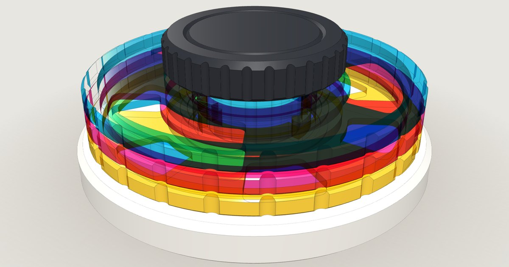
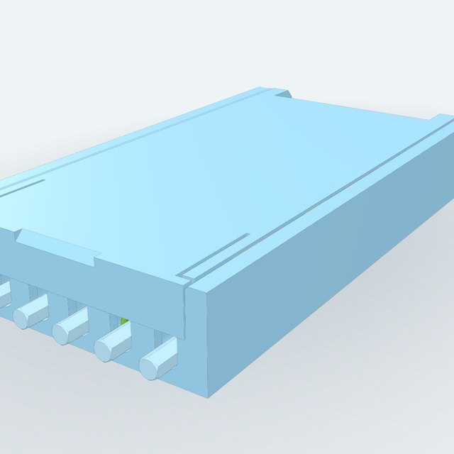
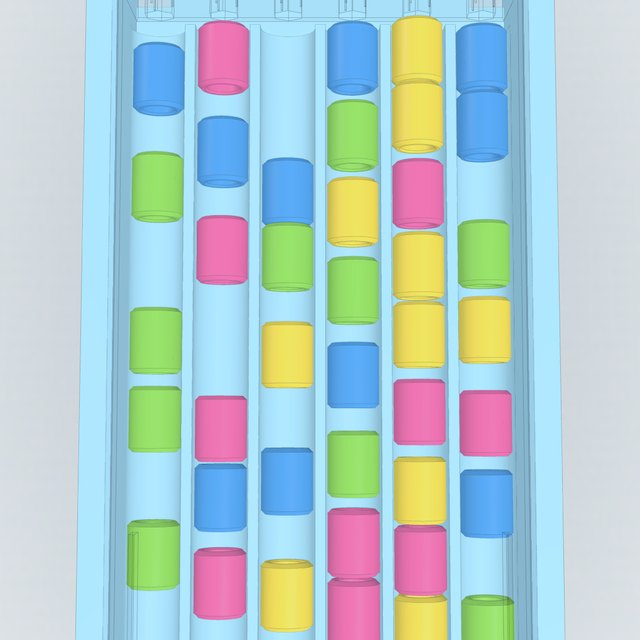
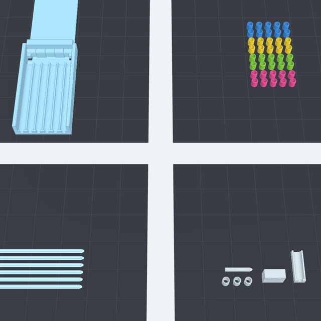

# Ordina-colori

Gioco di ordinamento stampabile in 3D su **Bambu Lab P1S**: 40 anelli in 4 colori su 6 aste, da riordinare
finché ogni asta ha un solo colore. Ispirato al *Mini Color Stack*: la scatola mescola gli anelli e li
riallinea da sola, senza toccarli uno a uno.

**Sito con modelli 3D, animazioni e partita giocabile:** https://davide6414.github.io/Color_toy_fidget_stack/



| Scatola chiusa | Dentro, dopo l'agitata | Piatti di stampa |
| --- | --- | --- |
|  |  |  |

## Come si gioca

1. **Sfila le aste.** A scatola chiusa si tira ogni asta per la coda: dopo un piccolo scatto scorre libera, gli anelli
   restano dentro.
2. **Agita.** Gli anelli sono più lunghi che larghi (10 contro 8 mm): possono fermarsi solo distesi lungo
   i 6 binari, con il foro già in asse.
3. **Reinfila le aste.** Di punta nella tacca, tenendola appoggiata sul fondo: attraversa gli anelli del binario e
   scatta in sede nella barra (la coda sporge di 5 mm).
4. **Apri il coperchio a 90°.** La barra è solidale al coperchio: le aste si alzano in verticale, il coperchio
   scatta e si ferma a 90°, e gli anelli scivolano sulla barra.
5. **Gioca.** Un anello alla volta dalla cima di un'asta all'altra, su un'asta vuota o sopra lo stesso
   colore, massimo 10 per asta. Vinci quando ogni asta ha un solo colore.
6. **Chiudi.** Anche a partita in corso: le aste tornano nei binari con gli anelli infilati.

## Cosa stampare

| File | Quantità | Orientamento | Note |
| --- | --- | --- | --- |
| [scatola.stl](stl/scatola.stl) | 1 | aperta a 180°, già orientata | print in place, nessuna pausa |
| [anelli_x10.stl](stl/anelli_x10.stl) | 4 piatti | in piedi | uno per colore (rosa, verde, giallo, blu), o tutti insieme con l'AMS |
| [aste_x6.stl](stl/aste_x6.stl) | 1 | distese su una faccia | strati lungo tutta la lunghezza |
| [piatto_di_prova.stl](stl/piatto_di_prova.stl) | 1 | già orientato | da stampare prima, per tarare i giochi e lo scatto delle aste |
| [stampa_prova.stl](stl/stampa_prova.stl) | 1 | un piatto, già orientato | poi questa: scatola mini, 1 asta, 1 anello; prova cerniera, chiusura e fermo a 90° |

**Stampa prova.** Prima dei ~100 g della scatola grande si può provare tutto il meccanismo con circa 32 g: la
stessa scatola con 3 binari da 3 anelli (chiusa 37,8 × 59 × 20 mm), un'asta da 51 mm e un anello, in un solo
piatto da 49 × 103 mm. Cerniera, linguette, fermi, tacche, sedi e giochi sono quelli veri. Non è in scala 1:2:
l'asta diventerebbe un esagono da 2 mm, la parete degli anelli 0,55 mm, e i giochi di stampa non si
possono dimezzare. Con meno di 3 binari le guance del coperchio finiscono sopra le nocche della base.
Nel sito è il pulsante *Stampa prova* in alto.

Tutto in un file: [ordina-colori-stl.zip](stl/ordina-colori-stl.zip). Nessun supporto, nessun brim.
Per Bambu Studio c'è anche il progetto con i 6 piatti già pronti, P1S 0.4, 0.20mm Standard e un filamento per
colore: [ordina-colori-bambu.3mf](stl/ordina-colori-bambu.3mf), il pulsante *Scarica 3MF* in alto nel sito.
Ugello 0,4, strato 0,2, PLA. Compensazione del piede d'elefante attiva (0,1–0,15 mm).

**Montaggio:** nessuno, e niente da comprare. Finita la stampa si piega il coperchio per sbloccare la
cerniera: passati i 90° le guance scavalcano i due dentini del fermo con uno scatto deciso, una volta sola.
Poi si chiude con lo scatto delle linguette e si infilano le aste.

Ingombro: scatola chiusa 68,4 × 129 × 20 mm (più 5 mm di code delle aste), aperta 242,8 mm.

## Scelte costruttive

- **Cerniera print in place con l'asse a metà altezza.** Base e coperchio si stampano entrambi appoggiati sul
  piatto solo se l'asse sta a metà dei 20 mm di altezza. Nocche alternate base/coperchio di raggio 3,5 con
  perni conici a 45° e 0,3 mm di gioco. Le nocche del coperchio sono l'inviluppo del cilindro e della nervatura,
  e lo spigolo basso posteriore delle pareti è smussato a 45°: in stampa non restano sbalzi orizzontali.
- **Barra solidale al coperchio.** Ruota sempre davanti all'asse; i binari finiscono 2 mm prima della barra
  per lasciar passare il suo spigolo inferiore.
- **Sedi profonde 12 mm.** L'asta si infila e basta: a tenerla dritta è solo la sede. Tolti i 3 mm della punta
  conica restano circa 9,7 mm di esagono pieno, e con 0,125 mm di gioco per lato l'asta si inclina al massimo
  di 1,6–1,8° (3–3,4 mm in cima, 109 mm sopra la barra). Con sedi da 8 mm erano 2,7–3,1° (5–6 mm). Se dal
  piatto di prova le aste ballano ancora, il gioco asta ↔ sede a 0,075 mm porta a circa 1° (2 mm).
- **Fermo a scatto a 90°, senza magneti.** A 90° il baricentro del coperchio con aste e anelli sta 1,9 mm
  dietro l'asse, quindi da solo ricadrebbe oltre i 90°.
  - In ogni parete laterale, sotto l'asse, la pelle interna è una linguetta lunga 16 mm (si flette nel piano
    degli strati) con un dentino che entra di 1 mm nel percorso della guancia del coperchio.
  - Da chiuso a 90° il dentino non tocca niente. A 90° la faccia inferiore della guancia, che passa per l'asse,
    ci batte contro: la linguetta lavora di punta e il fermo è rigido.
  - Un rilievo di 0,4 mm sotto la guancia scavalca il dentino con un clic aprendo e chiudendo (0,28% di
    deformazione): per richiudere servono circa 0,6 N sul bordo del coperchio (1,4 N nella stampa prova).
  - La scatola si stampa aperta a 180°, con il dentino in una tasca della guancia. Alla prima chiusura uno
    scivolo lo spinge di lato di 1 mm (0,7%, una volta sola) e da lì il coperchio non torna più oltre i 90°.
  - Niente magneti e niente pausa: la stampa va in un colpo solo.
- **Chiusura frontale a scatto.** Due linguette elastiche ricavate nel piano del coperchio (si flettono nel
  piano degli strati, 0,6% di deformazione) con un dentino a 45° che scatta in una sede delle pareti.
  Niente magneti né pause.
- **Tacche frontali** con il fondo concentrico all'asse dei binari e un invito a 45° di 0,5 mm in cima, che
  raccoglie la coda dell'asta quando il coperchio si chiude; aprendo, lasciano salire la coda delle aste.
- **Archi nella gonna.** A 90° la gonna frontale del coperchio sta in cima alle aste, e un anello che esce dalla
  coda deve passarci sotto. Sopra ogni tacca c'è un arco di raggio D/2 + gioco + 0,5 (4,8 mm), smussato sulle
  due facce. Senza archi gli anelli non uscirebbero dalle aste. La gonna appoggia ancora sulla parete tra un arco e
  l'altro (12,5 mm²) e sopra ogni tacca resta una lunetta di 2,35 mm, troppo bassa per un anello.
- **Scatto delle aste nella sede.** Un'asta in sede gira col coperchio a ogni apertura, quindi lungo la coda,
  dove passano gli anelli, niente del coperchio può toccarla: la presa sta dentro la sede.
  - Per ogni sede c'è una linguetta ricavata nel coperchio vicino alla cerniera (1,6 × 20 mm, si flette nel piano
    degli strati) con un pilastrino che scende nella barra. Sul pilastrino c'è un dentino a 35° che preme sulla
    faccia dell'asta.
  - L'asta ha una gola esagonale (3,45 mm tra le facce) a 7,3 mm dalla punta, dove il dentino scatta.
  - Per sfilarla servono circa 0,75 N (circa 38 volte il suo peso), poi 0,3 N per qualche millimetro.
    Infilandola, la punta conica spinge via il dentino e in fondo si sente lo scatto. Tiene anche a 90°.
  - La forza si regola col cursore *Scatto aste* (0,35–0,7 mm, 0,53–1,06 N).
  - La linguetta si deforma dello 0,19%, la radice del pilastrino lavora a 3,9 MPa attraverso gli strati.
  - Ogni pilastrino sta in un vano aperto sotto la barra, che dopo la stampa si pulisce con una lama sottile.
  - Non premere con oggetti a punta sulle 6 fessure del coperchio: una linguetta schiacciata fino in fondo
    arriva all'1,8% di deformazione.
  - Una caduta con un colpo deciso sul fronte può far uscire un'asta di qualche millimetro: si rispinge fino
    allo scatto.
- **Regole di gioco** come il Color Stack originale (un anello alla volta, solo su asta vuota o sullo stesso
  colore, massimo 10). Nel sito c'è anche la regola libera e un risolutore che dice se la mescolata è
  risolvibile.

## Il sito

- Modello 3D interattivo: scatola aperta e chiusa, sezione lungo un binario, coperchio trasparente, piatti di stampa.
- Animazione della partita completa (6 passi) e del funzionamento di binari, tacche, barra, cerniera, fermo a 90° e linguette.
- Partita giocabile sulle aste verticali, con annulla, suggerimento e risoluzione automatica.
- Modello parametrico: giochi, sporgenza delle code, capienza, smussi e risoluzione si regolano dal pannello
  *Parametri*; gli STL scaricati usano i valori scelti.
- Guida di stampa per la P1S con le liste di controllo del piatto di prova e della stampa prova.

La geometria è generata con [manifold-3d](https://github.com/elalish/manifold) (booleane esatte, mesh sempre
chiuse) e visualizzata con [three.js](https://threejs.org/). Lo stesso codice gira in Node per produrre gli
STL della cartella `stl/` e per le verifiche.

## Verifiche automatiche

`npm test` controlla, con i parametri predefiniti e con i cursori agli estremi, sia la scatola sia la stampa prova:
- solidi chiusi e quote delle specifiche;
- esclusione delle posizioni sbagliate degli anelli (di traverso, in piedi, sopra un binario pieno);
- assieme senza compenetrazioni con 10 anelli per binario;
- rotazione del coperchio da 0° a 180° senza urti, anche con aste e anelli infilati;
- scatto delle linguette di chiusura;
- fermo a 90°: nessun contatto da 0° a 90° tranne il rilievo dello scatto, battuta oltre i 90°, passaggio
  unico dalla stampa a 180°, gioco di stampa attorno al dentino, linguette staccate da fondo e parete;
- a 90°, anelli che escono dalla coda di ogni asta senza toccare la gonna, spostati quanto permette il foro;
- scatto delle aste: flessione del dentino in sede, sulla gola, sulla faccia e ad asta libera; forze,
  deformazioni, giochi di stampa di linguette e pilastrini, vani aperti sotto la barra;
- piatti di stampa entro i 256 mm e senza sbalzi orizzontali, a parte i ponti da 3,2 mm sopra le linguette dello
  scatto e i sottosquadri da 1,3 mm del fermo;
- combinazioni miste dei cursori (gioco anello minimo con sede massima, cerniera massima con capienza minima,
  scatto massimo con coda lunga);
- regole e risolutore della partita.

## Struttura

```
index.html            sito (GitHub Pages)
css/style.css
js/params.js          parametri primari e quote derivate
js/geometry.js        solidi CSG di scatola, aste, anelli, piatti di stampa, piatto di prova e stampa prova
js/game.js            regole, agitata, risolutore (anche in js/solver-worker.js)
js/viewer.js          scena three.js, cinematica di coperchio, aste e anelli
js/sequences.js       animazioni d'uso e dei pezzi
js/play.js            partita sugli anelli 3D
js/main.js            interfaccia
tools/check.mjs       verifiche della geometria
tools/test-game.mjs   verifiche della logica di gioco
tools/build-stl.mjs   genera stl/*.stl e lo zip
```

## Sviluppo

```bash
npm install
npm test            # geometria e logica di gioco
npm run build:stl   # rigenera gli STL
npm run build:3mf   # rigenera il progetto Bambu Studio (serve Bambu Studio installato)
npm run serve       # http://localhost:8080
```

Il workflow `.github/workflows/pages.yml` verifica, rigenera gli STL e pubblica il sito a ogni push su `main`.
Va attivato una volta: **Settings → Pages → Source: GitHub Actions**.
